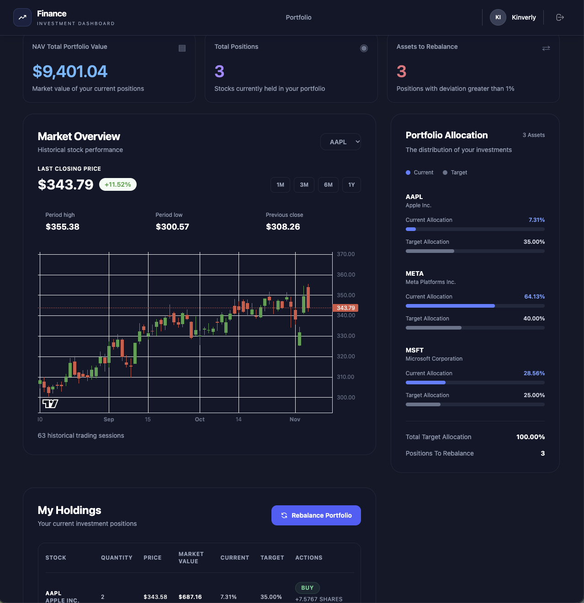

# Portfolio Management

A portfolio management application built with Ruby on Rails that allows users to track stock investments, define target asset allocations, monitor market performance, and calculate the trades required to rebalance their portfolios.



## Features

- **Portfolio Management:** Manage a portfolio containing multiple stock holdings.
- **Stock Prices:** Retrieve the latest available stock prices using the Financial Modeling Prep (FMP) API.
- **Target Allocations:** Define the desired percentage distribution for each stock in a portfolio.
- **Portfolio Overview:** Monitor total portfolio value, current positions, and asset allocation.
- **Rebalancing Recommendations:** Calculate which stocks should be bought or sold to reach the target allocation.
- **Historical Market Data:** Visualize historical stock prices through interactive candlestick charts.

## Tech Stack

- **Backend:** Ruby on Rails
- **Database:** SQLite
- **Frontend:** ERB, Tailwind CSS, Hotwire
- **UI Components:** ViewComponent
- **Stock Market Data:** Financial Modeling Prep (FMP) API
- **Testing:** RSpec

SQLite is used as the database to keep the project simple and easy to set up without requiring an external database server.

## Application Architecture

The application uses separate models to represent current investments and target allocations.

### Main Models

| Model | Responsibility |
|---|---|
| `Portfolio` | Represents an investment portfolio. |
| `Stock` | Represents a stock and stores its latest available price. |
| `PortfolioHolding` | Stores the quantity of each stock currently owned in a portfolio. |
| `PortfolioAllocation` | Defines the target percentage for each stock in a portfolio. |

This separation allows the application to distinguish between the stocks currently held and the stocks the portfolio is intended to contain.

### Rebalancing Service

The rebalancing logic is encapsulated in the `PortfolioRebalancer` service object.

Rather than placing business logic inside the controller or model, the service is responsible for calculating the recommended transactions.

The calculation follows these steps:

1. Retrieve the portfolio's current holdings and target allocations.
2. Obtain the latest available price for each relevant stock.
3. Calculate the total current market value of the portfolio.
4. Calculate the target value for each stock based on its allocation percentage.
5. Compare the current value against the target value.
6. Determine whether each stock should be bought, sold, or held.

#### Rebalancing Formula

The target value of each stock is calculated as:

```text
Target Value = Total Portfolio Value × Target Allocation / 100
```

The difference between the target value and current value determines the recommended action:

```text
Difference = Target Value - Current Value
```

- **BUY:** The current stock value is below its target value.
- **SELL:** The current stock value is above its target value.
- **HOLD:** The current position is sufficiently close to its target value.

The service also calculates the estimated number of shares and transaction amount required to reach the target allocation.

#### Example

Consider a portfolio with a total market value of $10,000:

| Stock | Current Allocation | Target Allocation |
|---|---:|---:|
| AAPL | 10% | 40% |
| META | 65% | 40% |
| MSFT | 25% | 20% |

The rebalancing service recommends:

- BUY AAPL because its current allocation is below the target.
- SELL META because its current allocation exceeds the target.
- SELL MSFT because its current allocation exceeds the target.

These recommendations are calculated using current market prices and portfolio holdings.

## Getting Started

### Prerequisites

Make sure you have the following installed:

- Ruby
- Rails
- SQLite3
- Bundler

### Installation

Clone the repository:

```bash
git clone https://github.com/Lopfel/finance.git
cd finance
```

Install the dependencies:

```bash
bundle install
```

Prepare the SQLite database:

```bash
bin/rails db:prepare
```

This command creates the database and runs the pending migrations.

### Environment Variables

The application uses the Financial Modeling Prep API to retrieve stock market data.

Configure your API key using an environment variable:

```bash
FMP_API_KEY=your_api_key
```

Make sure the variable name matches the configuration used by the FMP client in your application.

You can obtain an API key from:

https://financialmodelingprep.com/

### Run the Application

Start the Rails server:

```bash
bin/rails server
```

Open the application in your browser:

```text
http://localhost:3000
```

### Database Commands

To reset the development database:

```bash
bin/rails db:reset
```

To load the sample data:

```bash
bin/rails db:seed
```

## Running Tests

Run the RSpec test suite:

```bash
bundle exec rspec
```

To run a specific test file:

```bash
bundle exec rspec spec/services/portfolio_rebalancer_spec.rb
```

## Design Decisions

A few decisions were made to keep the application simple while maintaining a clear separation of responsibilities:

- **SQLite:** Selected as the default database to simplify local setup and avoid requiring an external database server.
- **Service Objects:** The rebalancing algorithm is isolated in `PortfolioRebalancer` to keep business logic independent of controllers and views.
- **Separate Holdings and Allocations:** Current positions and target investment distributions are represented independently.
- **ViewComponents:** Reusable interface elements are extracted into small components to improve maintainability.
- **FMP Integration:** External market data is used to calculate portfolio values based on the latest available stock prices.

## Assumptions and Limitations

- Target allocations are expressed as percentages and are expected to total 100%.
- Rebalancing calculations use the portfolio's current market value.
- Fractional shares are supported by the calculation.
- Transaction fees, taxes, and market price fluctuations during execution are not included.
- The application generates recommendations but does not execute real stock transactions.
- Stock price availability depends on the external FMP API and its subscription limits.

## Future Improvements

Potential improvements include:

- Automatic periodic stock price updates using background jobs.
- Additional validation for target allocations.
- Support for transaction history and portfolio performance tracking.
- More comprehensive tests for rebalancing edge cases.
- Integration with a brokerage API for actual trade execution.

## AI-Assisted Development

AI tools were used as development assistants during the implementation process, including discussions about application architecture, database design, service objects, rebalancing calculations, testing, and code improvements.

The development conversations can be shared separately as requested.

---

**Note:** This project is a portfolio management exercise intended to demonstrate Ruby on Rails application design, business logic implementation, and stock portfolio rebalancing. It is not a brokerage platform and does not execute financial transactions.